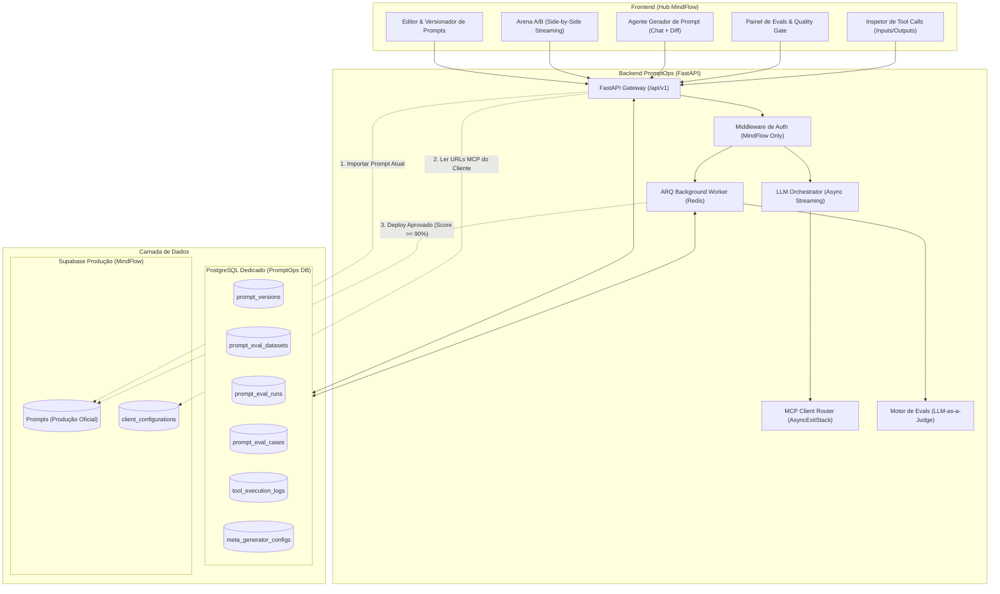

# Arquitetura — Plataforma PromptOps (MindFlow)

## 1. Visão Geral

A plataforma **PromptOps** é o ambiente centralizado da MindFlow para criação, versionamento, experimentação e avaliação automatizada de prompts de IA para múltiplos clientes.

O sistema opera de forma desacoplada dos fluxos em produção, garantindo:
- **Segurança:** Nenhuma alteração é aplicada em produção sem atingir o limiar mínimo de **90% de aprovação** nas baterias de testes (Quality Gate).
- **Eficiência de Banco:** Quase zero tráfego no Supabase operacional durante a criação e testes de prompts, utilizando um banco PostgreSQL dedicado para todo o ciclo de vida e histórico de experimentação.
- **Rastreabilidade:** Versionamento completo estilo Git com commits, diffs visuais, logs de execução de ferramentas reais (MCP) e histórico de avaliações.

---

## 2. Diagrama de Arquitetura

---

## 3. Divisão de Bancos de Dados

### 3.1 Supabase (Produção — Alta Criticidade / Baixo Tráfego de PromptOps)
* Acesso restrito via `service_role` key.
* **Operações permitidas:**
  1. `SELECT`: Carregar o prompt atualmente ativo na tabela `Prompts` por `id`.
  2. `SELECT`: Obter configurações e URLs de MCP de `client_configurations`.
  3. `UPDATE`: Atualizar o campo `Prompt_Text` (e colunas relacionadas) da linha existente na tabela `Prompts` quando uma versão atingir **>= 90%** nas evals.
* **Proibição:** Nunca gravar rascunhos, histórico de testes ou logs de evals no Supabase para evitar custos e esgotamento de conexões/egress.

### 3.2 PostgreSQL Dedicado (PromptOps DB — Alta Intensidade)
* Banco próprio hospedado na infraestrutura Easypanel / Docker.
* Responsável por todo o ciclo de rascunhos, datasets de teste, logs de cada turno da arena, respostas de ferramentas e histórico de métricas.

---

## 4. Componentes Centrais

### 4.1 Arena de Testes (Single & Dual Mode)
* Permite comparar duas versões simultaneamente (ex: `v1.0.0 (Produção)` vs `v1.1.0 (Draft)`).
* Um único input do usuário dispara chamadas assíncronas concorrentes (`asyncio.gather`).
* Stream de tokens em tempo real via Server-Sent Events (SSE).
* Injeção dinâmica de variáveis de contexto (`{customer_name}`, `{data_atual_iso}`, etc.).

### 4.2 Inspetor e Executor de Ferramentas (MCP)
* Conecta-se diretamente aos servidores MCP reais do cliente especificados em `client_configurations.mcp_urls` (ex: `schedule_service`).
* Gerenciamento concorrente das sessões MCP via `AsyncExitStack` (FastMCP / MCP SDK em Python).
* Exibição detalhada de cada invocação de ferramenta na interface:
  * Nome da Tool chamada
  * Argumentos enviados (JSON)
  * Resposta bruta retornada pela Tool (JSON)
  * Duração e status de execução

### 4.3 Pipeline de Avaliação (Evaluations)
* **Single-turn:** Pergunta -> Resposta única -> Avaliação com rubrica.
* **Multi-turn:** Simulação de diálogo completo entre o bot e um **Lead Simulator** que desafia o bot com objeções reais.
* **LLM-as-a-Judge:** Modelo sênior com rubricas estritas de conformidade, tom de voz, não-alucinação e uso correto de ferramentas.
* **Quality Gate:** Bloqueio programático de deploy se o score final for inferior a 90%.

### 4.4 Agente Gerador de Prompt (Meta-Prompting)
* Copiloto conversacional especializado em engenharia de prompt.
* Analisa o prompt atual + falhas ocorridas na arena + instruções do engenheiro.
* Produz alterações em formato de **Diff Visual Unificado** (adições e remoções), permitindo aceitar/rejeitar antes de gerar um novo rascunho.
